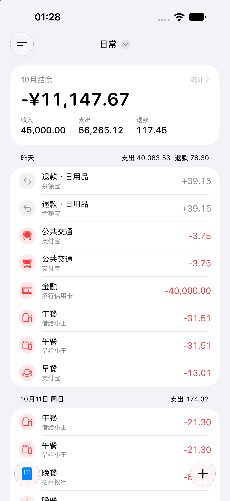
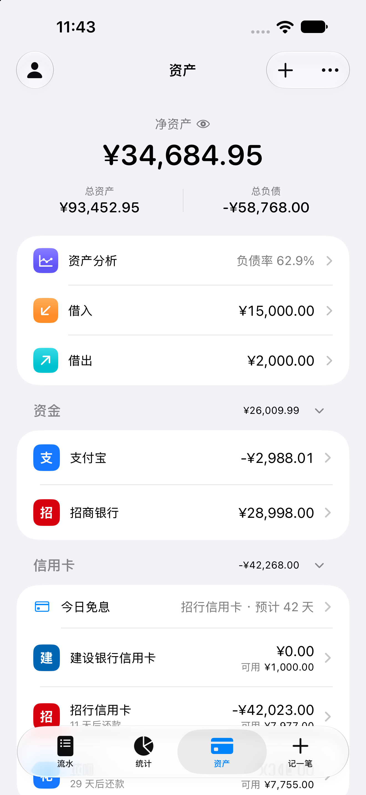
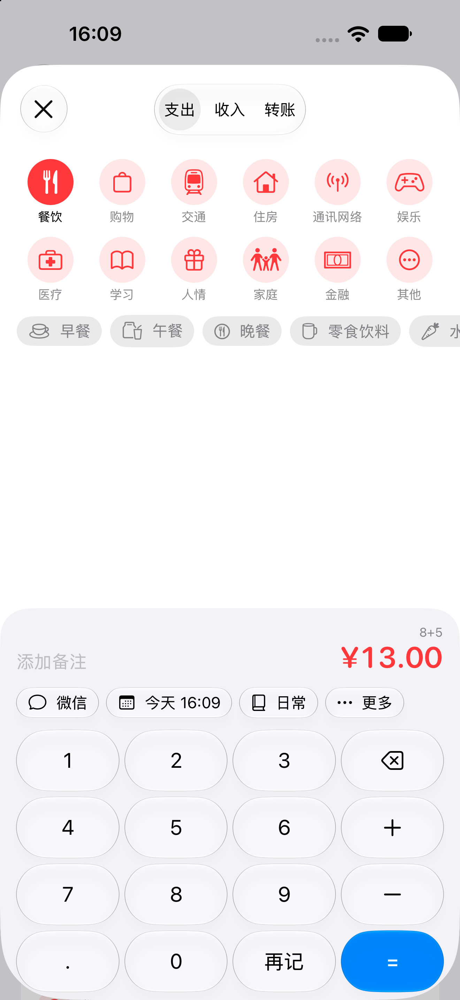
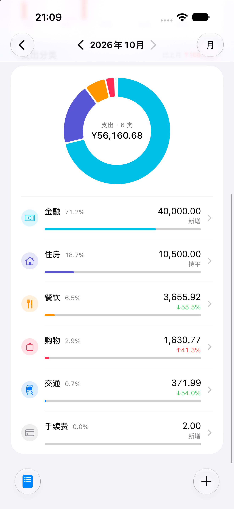

# 钱呢 · Qianne

### 钱呢？让每一笔钱，都有清楚的去向。

一款本地优先、原生体验的记账与资产管理 App。

从日常收支到账户资产，帮你看清钱去哪了、还剩多少、哪些钱还没收回来。

**原生体验 · 本地优先 · 规则一致**

---

## 版本信息

| 项目 | 当前信息 |
| --- | --- |
| App 版本 | **0.4.0** |
| 构建号 | **5**（App 内显示为 `0.4.0 (5)`） |
| 版本阶段 | 0.4.0 已发布 · 本地记账可日常使用 |
| 当前重点 | iPhone 原生体验 |
| 工程最低系统 | iOS 26.0 · macOS 26.0 |
| 信息核对日期 | 2026-11-07 |

当前发布版本为 **0.4.0 (5)**，发布于 2026 年 11 月 7 日；后续功能安排见下方路线图。

## 关于钱呢

钱呢希望让记账成为一件自然、轻松的事：快速记下一笔，随时查看流水，在需要时了解收支变化和资产状况。

我们从 iPhone 开始，以 SwiftUI 构建 Apple 原生客户端，逐步完善 iPad、Mac 体验；后续规划 Android、鸿蒙原生客户端，以及用于账号、同步与备份的 Go 后台。

## App 预览

从记下一笔，到看清收支与资产。以下为 iPhone 开发阶段界面截图，账户与金额使用演示数据，页面会随版本持续迭代。点击图片可查看原图。

<table>
  <tr>
    <td align="center" width="50%">
      <h3>日常流水</h3>
      
按天查看收支，掌握本月结余。

      
    </td>
    <td align="center" width="50%">
      <h3>资产总览</h3>
      
净资产、资金账户与信用账户一目了然。

      
    </td>
  </tr>
  <tr>
    <td align="center" width="50%">
      <h3>轻松记一笔</h3>
      
选择分类与账户，用数字键盘快速记录。

      
    </td>
    <td align="center" width="50%">
      <h3>收支分析</h3>
      
分类占比与变化排行，帮你看清钱的去向。

      
    </td>
  </tr>
</table>

## 核心功能

| 方向 | 内容 |
| --- | --- |
| 日常记账 | 支出、收入、转账，多账本管理；复制流水后修改保存，标签可整理和归档 |
| 资产管理 | 资金、信用、充值、投资等账户，资产分组，净资产与负债查看 |
| 账户详情 | 跨账本流水、余额走势、余额校准与账户管理 |
| 退款与报销 | 关联原支出查看退款，跟踪垫付与待报销款项 |
| 借入与借出 | 管理应付、应收，了解尚未归还或收回的金额 |
| 收支分析 | 月度、年度汇总，支出扣除退款和报销垫付款，趋势、分类排行与明细查看 |
| 分类与预算 | 月度和年度预算、二级分类预算；记账时查看剩余、超支提醒、上月结转和预计支出 |
| 周期账与提醒 | 房租、订阅、工资等自动入账，可多选执行日、设置执行次数；信用卡还款可提前提醒 |
| 卡片与分期 | 保存卡片资料，完整卡号加密并通过面容 ID 查看；了解本期应还和未出账，预览各期本金及手续费 |
| 截图记账 | 识别账单截图并预填记账页，分类和标签从记账习惯中学习，确认后保存 |
| 桌面小组件 | 九种小组件，查看支出、预算、趋势、净资产与还款提醒，也可快速打开记账 |

## 我们坚持的原则

- **本地优先**：当前 MVP 在本地 SQLite 中完成读写，核心记账不依赖后台连接。
- **原生体验**：各平台采用原生技术，尊重平台的交互习惯。
- **一套业务标准**：数据模型、计算规则和共享测试用例统一维护，各端实现保持一致。
- **金额准确**：金额使用最小货币单位的整数表示，余额、统计与预算按统一规则计算。
- **记录可追溯**：余额由初始金额和流水推导；退款、报销与余额调整各有明确的计算边界。

## 仓库导航

| 仓库 | 职责 | 技术 |
| --- | --- | --- |
| [qianne-apple](https://github.com/qianne-app/qianne-apple) | Apple 客户端、领域规则与本地存储 | Swift 6 · SwiftUI · GRDB · SQLite |
| [qianne-spec](https://github.com/qianne-app/qianne-spec) | 跨端数据模型、业务规则、SQLite 基准结构、同步协议草案与共享测试 | Markdown · SQL · JSON · Go 参考实现 |

以上两个仓库目前为私有仓库，访问需要相应权限。本页用于公开介绍项目。

## 路线图

**目标：钱呢 1.0 登陆 App Store。** 我们不赶时间，1.0 会是一个完整的版本：本地记账、账号、多设备同步、共享账本，并覆盖 iPhone、iPad、Mac 和 Apple Watch。

| 版本 | 内容 | 状态 |
| --- | --- | --- |
| 0.3 本地记账可用 | 流水、退款报销、借贷、信用卡、多账本、统计与资产分析、钱迹导入、导出、备份恢复 | ✅ 已完成 |
| 0.4 日常记账完整 | 周期账与还款提醒、卡片资料、本期应还与分期、预算完善、截图记账、九种小组件、流水复制与标签归档 | ✅ 已完成 |
| 0.5 数据能力补全 | 多币种、流水附件图片 | 📋 下一步 |
| 0.6 账号与多设备同步 | Go 后台、账号体系、离线优先的增量同步、备份加密 | 📋 计划中 |
| 0.7 苹果生态 | iPad、Mac、Apple Watch 正式版 | 📋 计划中 |
| 0.8 共享账本 | 邀请成员一起记账，按角色管理权限 | 📋 计划中 |
| 0.9 上架准备 | 新手引导、更多记账 App 的导入、深色模式与无障碍、隐私合规、TestFlight 内测 | 📋 计划中 |

**后续计划**：记账模板、文字记账、语音记账、快捷指令与 Siri 记账，以及备份还原时携带标签显示方式和提醒设置。

**1.0 之后**：Android、鸿蒙客户端。

路线图会随开发进展更新，具体发布时间与可用范围以实际版本为准。

## 平台与数据

当前以 iPhone 原生体验和本地数据为主，核心记账功能离线可用。iPad、Mac、Apple Watch、账号与多设备同步，以及共享账本会按路线图逐步完善。

---

**钱呢 · 把账记清，把钱看明白。**

